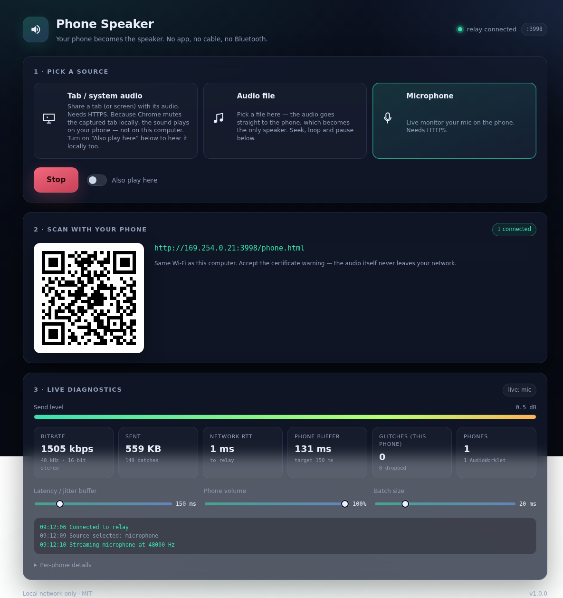
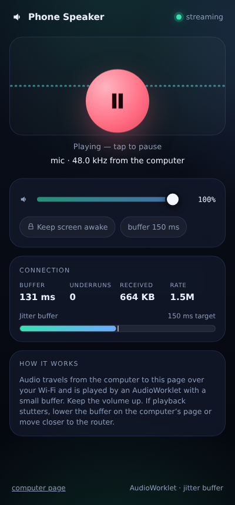

# 🔊 Phone Speaker

**Turn your phone into a wireless speaker for your PC or laptop.**
Run one tiny server on your computer, scan a QR code with your phone, and everything the computer plays comes out of the phone — **no app install, no cables, no Bluetooth pairing.**

<p align="center">
  
  
</p>

| | |
|---|---|
| **Runs on** | Computer: Node.js 18+ · Phone: any modern browser (Chrome / Safari / Firefox / Edge) |
| **Connection** | Same Wi-Fi network; the phone opens a plain URL — zero install |
| **Audio** | 48 kHz · 16-bit · stereo PCM, sent in ~20 ms batches |
| **Latency** | ≈ 0.2–0.5 s end to end (adjustable jitter buffer, default 150 ms) |
| **License** | MIT |

---

## Features

- 🔊 **Three audio sources** — tab or system audio (via `getDisplayMedia`), audio files (the phone becomes the *only* speaker), or the microphone.
- 📲 **Zero install on the phone** — scan the QR code → tap ▶ → done.
- 🎛 **Live controls** — volume on both ends, latency / jitter-buffer slider, pause, loop, seek, and an **“Also play here”** monitor toggle.
- 📊 **Live diagnostics** — bitrate, bytes sent, network RTT, phone buffer depth, dropped frames, glitch counter, per-phone details.
- 📡 **Multi-phone** — one computer can stream to several phones at once.
- 🔁 **Adaptive jitter buffer** — an AudioWorklet ring buffer with hysteresis priming, underrun recovery and automatic resampling. It also absorbs the clock difference between the two devices (e.g. 48 000.4 Hz vs 47 998.9 Hz), so latency stays flat for hours. If the phone's browser can't run AudioWorklet, a scheduled-buffer fallback keeps the sound going.
- 🔒 **HTTPS built in** — an auto-generated self-signed certificate (port 3443) so tab/system capture and microphone capture work over the LAN.
- 🧪 **Tested** — `npm test` (8 protocol/relay assertions) and `npm run test:e2e` (22 real-Chromium end-to-end assertions over the entire audio pipeline).

### How it works

```
┌─ PC browser ───────────────┐      ┌─ Node server (this PC) ─┐      ┌─ Phone browser ───────────┐
│ tab / system / file / mic   │ PCM  │ WebSocket relay         │ PCM  │ jitter buffer + worklet   │
│ → AudioWorklet (48 kHz)     │ ───► │ 1 sender → N receivers  │ ───► │ steer → speakers          │
└─────────────────────────────┘ 20ms └─────────────────────────┘ 20ms └───────────────────────────┘
```

1. The computer captures audio in a Web Audio **AudioWorklet** and converts it to little-endian 16-bit PCM batches.
2. Batches travel over a **WebSocket** to a small Node.js relay (HTTP + HTTPS, same port for both).
3. The phone drops them into a second **AudioWorklet** — a ring "jitter buffer" that smooths Wi-Fi jitter, compensates for clock drift, and plays ~150 ms behind the write head.

---

## Quick start

```bash
git clone https://github.com/Hrieeyzzz/phone-speaker.git
cd phone-speaker
npm install
npm start
```

Then:

1. Open the printed **Computer** URL — `http://localhost:3000/` (or the `https://…:3443/` one if you want tab or microphone capture).
2. Pick a source, press **Start sending**.
3. Scan the QR code with the phone (same Wi-Fi). Accept the certificate warning.
4. Tap **▶ Start** on the phone.

One-click launchers are included: `start.bat` (Windows) and `start.sh` (macOS/Linux).

### Environment variables

| Variable | Default | Meaning |
|---|---|---|
| `PORT` | `3000` | HTTP port (page + relay) |
| `HTTPS_PORT` | `3443` | HTTPS port (page + relay) |
| `NO_HTTPS` | unset | `1` disables the HTTPS listener entirely |
| `PHONE_SPEAKER_URL_FILE` | unset | write the startup URLs to this JSON file (used by tooling/tests) |

### Tests

```bash
npm test           # protocol & relay tests — no extra dependencies
npm run test:e2e   # full browser tests (see below)
npm run make:wav   # regenerate tests/test.wav
```

The browser suite needs Chromium once:

```bash
npm install --no-save playwright-core
npx playwright-core install chromium
npm run test:e2e
```

If you already have Chrome/Chromium, skip the download and point at it:

```bash
CHROME_PATH=/path/to/chrome npm run test:e2e   # HEADFUL=1 to watch
```

---

## Using each source

### Tab / system audio
Pick **Tab / system audio**, choose a tab (or *Entire screen*) and tick **Also share tab audio** (Chrome) / pick *Share system audio* (Edge). Chrome mutes the captured tab locally, so the sound comes out of the phone — turn on **Also play here** to hear it on the computer too.

> Needs the HTTPS page. Choose *Entire screen* + system audio to capture everything, not just one tab.

### Audio file
Pick **Audio file** and choose a file (`mp3`, `m4a`, `wav`, `ogg`, `flac`, …). The audio goes only to the phone: the computer decodes it but never sends it to its own speakers. Seek, loop and pause from the transport bar. When the file ends, press **Start sending** again to replay it.

### Microphone
Pick **Microphone**, allow permission, press **Start sending**. Useful for live monitoring, karaoke or testing the phone's speaker.

---

## Troubleshooting

| Symptom | Fix |
|---|---|
| **No audio on the phone** | Tap ▶ on the phone page (browsers block audio until a gesture). Check volume on both ends. |
| **“No audio track — tick Also share tab audio”** | In Chrome's picker, the *Share tab audio* checkbox must be on. Otherwise the tab is shared video-only. |
| **Tab / mic buttons are disabled** | Open the **https://** URL instead of `http://`. Capture and AudioWorklet require a secure context. |
| **“Your connection is not private”** | Expected for the self-signed certificate — choose *Advanced → Proceed*. It is generated locally on first run and stored in `.certs/`. |
| **Phone can't open the QR URL** | Phone and computer must be on the same Wi-Fi, and the network must allow client-to-client traffic (guest/AP-isolated networks don't). |
| **Stuttering / crackles** | Raise **Latency / jitter buffer** (e.g. 250–400 ms), move closer to the router, or stop large downloads. The phone page shows underruns live. |
| **High latency (~0.5 s+)** | Lower the buffer to 80–100 ms. Bluetooth headphones on the phone add their own 150–300 ms on top. |
| **Nothing happens on tap** | Safari on iOS needs the page in the foreground once; then use **Keep screen awake**. |
| **Port already in use** | `PORT=8080 HTTPS_PORT=8443 npm start`. |

---

## Project layout

```
phone-speaker/
├── server.js              # HTTP/HTTPS static server + WebSocket relay
├── package.json
├── start.bat / start.sh   # one-click launchers
├── relay-test.js          # headless protocol/relay tests (8 checks)
├── tests/
│   ├── e2e.js             # full browser E2E tests (22 checks)
│   ├── make-wav.js        # generates the test audio file
│   └── test.wav
├── docs/                  # screenshots for this README
└── public/
    ├── index.html         # computer page
    ├── app-pc.js          # capture, sender, diagnostics
    ├── pc.css
    ├── phone.html         # phone page
    ├── app-phone.js       # receiver, buffer UI, visualiser
    ├── phone.css
    ├── pcm-capture.js     # AudioWorklet: audio → PCM batches
    └── pcm-player.js      # AudioWorklet: jitter buffer + drift correction
```

## License

MIT — see [LICENSE](LICENSE).
